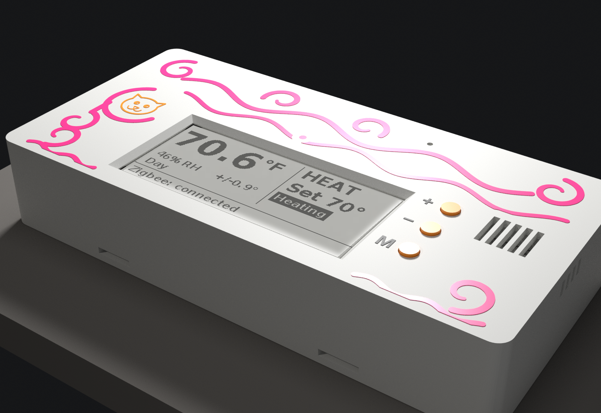
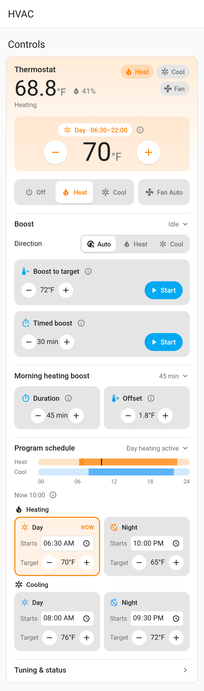
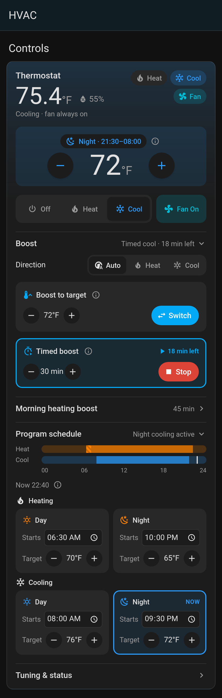
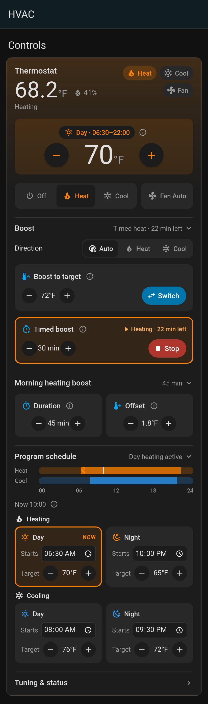
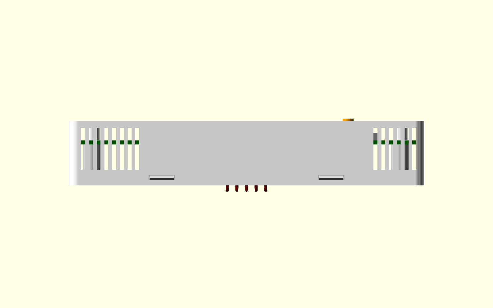

# Thermostat V3

Shared as-is — not seeking contributions or pull requests.

ESP32-C6 Zigbee thermostat for single-stage HVAC (R/C/W/Y/G), with e-paper display, SHT40 temperature/humidity sensor, and triac outputs. Designed for JLCPCB assembly.

## Gallery



On-device screens (296×128 e-paper, shown at 2×; °F):

| Home | Menu |
|---|---|
|  |  |
| **Schedule** | **Boost to** |
|  |  |

Home Assistant Lovelace card ([install](firmware/ha/lovelace-card/README.md)):

| Heat, day (light) | Cool, night (dark) | Timed heat boost (dark) |
|---|---|---|
|  |  |  |

More: case renders in [case/](case/), every menu screen in [firmware/README.md](firmware/README.md).

## Case

The case (`case/thermostat_case.scad`) is a 147 × 71 × 26.8 mm PETG shell and backplate for a Bambu P2S with a 0.4 mm nozzle. It prints without supports. The front face — window, cat, swirls, and buttons — is unchanged.



Air inside the case is split into three zones:

- **Hot zone** (left). The triacs, the opto drive side, the buck, and the bridge. Slots in the bottom edge and the lower left wall let room air in. Matching slots in the top edge and the upper left wall let it out. A front curtain just left of the display keeps that air from spilling under the panel.
- **Middle zone.** The ESP32-C6, the display, and the wiring hole. No new vents here. Fill the hole in the wall around the cable with putty. That air now stays in the middle zone.
- **Sensor duct** (right). The SHT40 island. Bottom-edge slots and a band of slots on the right wall feed it. The top-edge slots and the existing front island slots exhaust it. Two ribs on the backplate and a partition in the shell separate it from the middle zone. The old slots in the backplate under the island are gone: they faced the drywall, and they opened the duct onto the wall.

The ribs stop 0.4 mm short of the board, and above the lip they run out to the lip's outer face so they come within 0.3 mm of the shell. Every new wall keeps at least 0.5 mm off the parts, including the USB-C shield legs and locating peg on the back of the board. Front clearances include the ±0.16 mm board-thickness tolerance.

**Expected benefit.** A zonal model puts the triac-induced sensor rise about **10–25% lower** than the open case this replaces. That is a model, not a measurement. Most of the remaining error is heat flowing along the PCB ground pour, which a case cannot stop, and the vents themselves carry only a small share of the hot zone's heat. The walls matter more than the hole count: they also help keep wall-cavity air from the wiring hole away from the sensor.

**Check it.** Log a heat call and a cool call against a reference thermometer, with a clamp meter on W, Y, and G. Taping the new edge slots only removes the vents, about 6% of the model. It is not the old airflow: the ribs, the partition, and the curtain stay, so that A/B will likely show little difference. A true before/after needs a print of the previous case revision. `CONFIG_THERMO_SELF_HEAT_OFFSET_C100` defaults to 0. About −0.1 °C is a suggested starting value to set via ZHA after that log, not a configured default.

`board.stl` is not in the repo. From the repo root, export the populated board with KiCad 9 (do not pass `--drill-origin`; `scripts/case_fit.py` places the model):

```
kicad-cli pcb export stl -o board.stl --force --cut-vias-in-body kicad/thermostat-v3.kicad_pcb
```

The script header also has the OpenSCAD lines for the assembly-frame `back.stl` and `shell.stl` it checks against.

- kicad/: KiCad 9 project
- fab/: Gerbers plus JLC BOM/CPL
- part-plan.md: part choices, sources, cost estimate
- v2-original/: the previous V2 design

Warning: don't connect USB while 24VAC is wired unless you use a USB isolator.
First-time flashing on Arch Linux: [docs/flashing-arch.md](docs/flashing-arch.md).

This project is shared as-is. It is not seeking contributions or pull requests.

## License

MIT — see [LICENSE](LICENSE). Third-party notices (Lit, Material Design Icons, DejaVu/Bitstream,
Espressif, Good Display sequences, LCSC STEP models, …) are in [NOTICE](NOTICE).

## Security

This is a DIY thermostat that switches 24 VAC HVAC loads. Treat the Zigbee network perimeter as
the security boundary:

- **OTA is unsigned.** The device accepts Zigbee OTA images and installs them with `esp_ota_*`
  (rollback via pending-verify exists). Anyone who can run an OTA server the device trusts can
  push firmware. There is no image signature check.
- **Join policy is open.** `install_code_policy` is false, so pairing uses the Zigbee 3.0
  well-known trust-center link-key path (normal for Home Assistant / ZHA). Don't leave the
  network open to joining when you aren't pairing.
- **USB Serial/JTAG console** is enabled in `sdkconfig.defaults`. Physical USB access to the
  board gives a console.
- Factory reset from the on-device menu is intentional.

See also [MANUFACTURER_ID.md](MANUFACTURER_ID.md) for the Zigbee manufacturer code (`0x434E`:
this project's DIY code from the quiet `0x3000`–`0x5FFF` band; not CSA-assigned, not certified).

## Third-party / display provenance

E-paper driver sequences in `firmware/components/display/ssd1680.c` follow Good Display's
GDEY029T94 sample/datasheet (not a verbatim copy of their sample tree). Full attribution is
in [NOTICE](NOTICE).

