# Thermostat V3 firmware (prototype)

ESP-IDF firmware for **Connie's Super Awesome Thermostat V3**: an ESP32-C6 that runs as a Zigbee 3.0
HA thermostat for a single-stage gas furnace plus AC, with 24 VAC W/Y/G triac outputs.

> **Status: prototype.** It builds for esp32c6, and the host unit tests pass. It has **not run on
> real hardware yet**, because no V3 board exists. Check every item under *Bring-up checklist*
> before you wire it to the HVAC system.

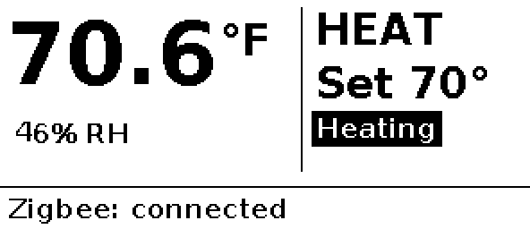
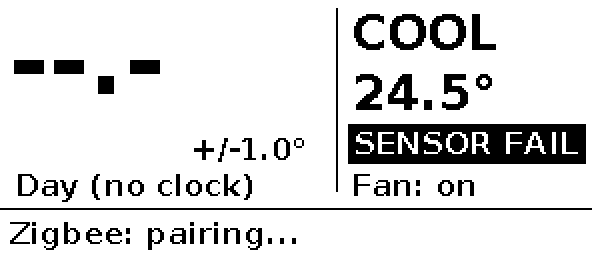

*(Rendered on the host by the unit tests with the same rendering code the firmware uses.)*

## Layout

| Component | What it does | Hardware-free? |
|---|---|---|
| `components/control` | Thermostat logic: hysteresis, minimum on/off times, changeover, fan run-on, failsafe | **yes**, pure C |
| `components/hvac_outputs` | `hvac_interlock.c` (pure) is the **single** W/Y interlock. `hvac_outputs.c` is the only code that touches DRV_W/Y/G | interlock: yes |
| `components/sensor` | SHT40 over I2C (`sht40_parse.c` handles CRC and conversion and is pure) | parser: yes |
| `components/display` | SSD1680/GDEY029T94 driver, 1-bpp graphics plus fonts, screen renderer (pure), refresh-policy task | renderer: yes |
| `components/control/schedule.c` | Day/night program schedule + morning heat boost | **yes**, pure C (`test/host/test_schedule.c`) |
| `components/ui` | Button debounce, auto-repeat and hold-stage state machine (pure), on-device menu state machine (pure), 10 ms sampler, LED | state machines: yes |
| `components/zigbee` | Endpoint and cluster model, commissioning, attribute writes, OTA client | no |
| `components/board` | Pin map (`board.h`), STWD100 driver | no |
| `main` | Wires it all together; NVS settings; health check and watchdog kick | no |
| `test/host` | Native unit tests (CMake, no ESP-IDF needed) | |
| `ha/zha_quirk/` | **ZHA quirk (quirks v2)** for the boost controls, plus its test and install notes | |
| `ha/dashboard-card.yaml` | Example HA dashboard card (thermostat + swing slider + boost) | |
| `z2m/thermostat-v3.js` | Zigbee2MQTT external converter (secondary) | |

### Tasks
- **app** (prio 6, 250 ms loop): reads the sensor every 2 s, runs the control step, writes outputs through the interlock, handles button events, publishes to Zigbee, saves to NVS (with a 5 s debounce), drives the LED, runs the health check and kicks the watchdogs.
- **display** (prio 3): renders and refreshes the e-paper. A refresh blocks for seconds, so it gets its own task and the control loop never waits on the panel.
- **zigbee** (prio 5): ZBOSS main loop. Remote writes come in through callbacks and go into the shared settings under a mutex.
- **esp_timer**: 10 ms button sampling, which feeds a queue.

## Control and safety rules

All of these live in `control.c`, and the tests in `test/host/test_control.c` cover them.

| Rule | Default |
|---|---|
| Temperature swing (hysteresis) | Configurable 0.1–1.0 °C, default ±0.5 °C, stored in NVS. Heat on at SP−swing, off at SP+swing; cooling is the mirror image. Minimum on/off times and changeover delays still apply on top. Set from HA (*Temperature swing* number, Zigbee 0xFC57/0x0010); shown on the e-paper as `+/-0.5°` next to the humidity (in °F when the display is in °F) |
| Modes | Off / Heat / Cool. **There is no Auto (heat/cool changeover) mode**: the program schedule replaced it. Heat and cool setpoints are independent (no deadband), because only one of them is ever active |
| Setpoint range | 10.0–32.0 °C |
| **Compressor minimum off-time** | **5 min**, also applied from boot, so a power blip can't short-cycle the compressor |
| Compressor minimum on-time | 3 min. Mode change or failsafe stops it immediately |
| Furnace minimum on/off | 2 min / 1 min |
| Heat↔cool changeover | 5 min between one stage stopping and the other starting |
| Fan mode | Auto: G only with Y (and W when `heatDrivesFan`) plus run-on. **On: G runs continuously, even with no heat/cool demand, in every mode including Off** (still killed by the failsafe). Set from HA (Fan Control 0x0202 FanMode, ZHA fan control / climate fan mode) or the menu (*Fan*) |
| Fan run-on | G stays on 90 s after W and 45 s after Y. G is energised with Y. With W it's left to the furnace (`heatDrivesFan=false`) |
| **Failsafe** | No valid reading for 30 s, **or** a reading outside 0–45 °C, turns **all outputs off immediately** (overriding the minimum on-time and the fan run-on). Recovery needs 3 consecutive good readings. The firmware boots in failsafe |
| **W/Y interlock** | `HvacInterlock()` is the only path to the pins. If W and Y are both requested, both are dropped and a fault is counted. That fault makes the loop unhealthy, so it stops kicking and the watchdogs reset the chip |
| **Watchdog** | The STWD100 (about 1.6 s) is armed 10 s after boot, and only after the loop has run cleanly. It's kicked once per 250 ms loop, and only while the health check passes (no interlock fault; a stalled display is reported but deliberately not a reason to reset). The IDF task watchdog (5 s) watches the same loop as a second layer. A watchdog reset puts the GPIOs in high-Z, and the 10k pull-downs then switch every triac off |

| **Output readback** | W/Y/G pins are INPUT_OUTPUT and the pad is read back on the **next** 250 ms pass (≥ 1 ms after the last change, past the C6 input synchroniser), never right after the write. **2 consecutive** mismatches, or a `gpio_set_level` error, latch an OUTPUT FAULT: everything off, shown on screen, no reboot. G is raised before Y, and Y is never raised if G failed. The latch is **re-tested after 10 min** (longer than every min-off/changeover time, so resuming cannot short-cycle), only while the pads read "all off", at most 3 times per boot; then it stays off until reboot. `gpio_config` failure at boot is permanent. **Readback only sees the ESP32 pad: it cannot detect a shorted (or open) triac, a dead MOC3063 or a wiring fault**, and must be verified on real hardware with the MOC3063s loaded (that the loaded pad still reads back its driven level) |
| **Boot-loop guard** | NVS `boot/n` counts boots that end before 3 min of healthy uptime. Software restarts (`ESP_RST_SW`: OTA reboot/rollback, factory reset, safe-mode retry) are not counted; power-on resets are, because an STWD100 reset pulls CHIP_EN and reports as power-on (so 5 quick power cycles also enter safe mode). At 5: SAFE MODE (outputs off, STWD100 not armed, banner). After 30 min it reboots with the count set to 4: exactly one trial boot; one more counted reset goes straight back to safe mode. The counter is in its own namespace and **survives a factory reset** |

A one-week randomised soak test (temperature drift, random mode and setpoint changes, sensor dropouts,
garbage readings) checks the invariants on every simulated second.

## Program schedule (day/night)

Heating and cooling each have their own two-period program. **DAY** runs from the day start time up
to the night start time, **NIGHT** from the night start time up to the day start time; either period
may cross midnight (e.g. day 20:00 → night 04:00). If day and night start are equal the program is
effectively off and DAY applies all day. The heat program is used in HEAT mode, the cool program in COOL
mode (in OFF nothing runs; the display/HA show the program values and the *heating* program's period).

**Morning heating boost** (HEAT mode only): starting at *day heating start*, for *boost duration*
minutes, the heating setpoint is raised by *boost offset*. Duration 0 or offset 0 turns it off. The
boost is cut short at *night heating start* (it never runs into the night period) and doesn't run at all
when day and night heating start are equal. The
boost is applied to what the controller regulates to; the setpoint shown on the device and in HA's
climate card stays the program value (so editing it round-trips), and the screen says *Day, morning
boost* / HA's *Schedule period* sensor says `Day_morning_boost`. It is unrelated to the manual
(to-target / timed) boost below, which still overrides everything while it runs.

**Moving the main setpoint** (UP/DOWN on the device, or HA's climate setpoint = Occupied Heating /
Cooling Setpoint) **changes the setpoint of the current period** of the program for the mode you are in
(heat setpoint → heat program, cool setpoint → cool program) and is persisted. The other period is untouched.
During the morning boost the edit changes the underlying day value (the offset is kept).

**Time of day** comes from the coordinator via the Zigbee **Time cluster** (client on our endpoint 1):
5 s after joining/rejoining the device reads LocalTime (0x0007), with Time + TimeZone + DstShift as a
fallback, plus TimeStatus, from the coordinator, then re-reads hourly. An answer is only used if the time is
in a plausible range (2024–2100) and, when TimeStatus is returned, its Master or Synchronized bit is set (a
coordinator with an unset clock is ignored). Until the first usable answer, reads are retried after 1, 2 and
5 min, then hourly. Between syncs
the time is extrapolated with the monotonic clock. zigpy/ZHA answers these reads with the HA host's local time,
so DST changes are picked up within an hour. **Until the first sync after boot the time is unknown: the
DAY setpoints of both programs are held, no morning boost runs, setpoint edits go to the DAY period**, and
the screen shows *Day (no clock)* (*Schedule period* = `No_clock_holding_day`). Once known, the time is kept
across later network loss (extrapolated) until the next reboot.

| Setting | Attr (0xFC57) | Type | Default | Range |
|---|---|---|---|---|
| Day cooling start | 0x0020 | uint16 min after midnight | 480 (08:00) | 0–1439 |
| Day cooling temp | 0x0021 | int16 0.01 °C | 2450 (24.5 °C) | 1000–3200 |
| Night cooling start | 0x0022 | uint16 | 1320 (22:00) | 0–1439 |
| Night cooling temp | 0x0023 | int16 | 2400 (24.0 °C) | 1000–3200 |
| Day heating start | 0x0024 | uint16 | 360 (06:00) | 0–1439 |
| Day heating temp | 0x0025 | int16 | 2000 (20.0 °C) | 1000–3200 |
| Night heating start | 0x0026 | uint16 | 1320 (22:00) | 0–1439 |
| Night heating temp | 0x0027 | int16 | 1800 (18.0 °C) | 1000–3200 |
| Morning heating boost duration | 0x0028 | uint16 minutes | 120 (→ 06:00–08:00) | 0–240, 0 = off |
| Morning heating boost offset | 0x0029 | int16 0.01 °C | 50 (+0.5 °C) | 0–300 |
| Schedule period (read-only, reported) | 0x002A | enum8 | – | 0 no clock (holding day), 1 day, 2 night, 3 day + morning boost |

All are manufacturer-specific (code 0x131B) on the existing 0xFC57 cluster, persisted in NVS.

**Settings storage.** All settings live in one versioned blob, `{version, Persist}`, under the NVS key
`cfg3` (namespace `tstat`; a new key so it never collides with the 0.2.x `cfg` blob). The current layout is **version 1** (no hardware has shipped, so there are no
older layouts to migrate). A blob with an unknown version or size loads the defaults. A future layout change
bumps `SETTINGS_VERSION` and adds a migration branch in `SettingsDecode()` (`main/settings_codec.c`, host-tested
in `test/host/test_settings.c`).

### Design note: settings layout compatibility (OTA rollback)

Every future NVS layout change must be **one-version backward and forward compatible**, so an OTA rollback
always boots with the user's settings:

- A newer layout may only **append** fields to the end of `Persist`. Existing fields are never reordered,
  resized, retyped or repurposed, and the blob stays within `SETTINGS_BLOB_MAX` (256 bytes).
- Firmware one version older must read the newer blob: its decoder accepts a version ≥ its own and a size ≥
  what it expects, takes the fields it knows (the prefix) and ignores the rest. New data doesn't have to
  survive a rollback.
- Newer firmware must still load the older blob, by migrating it (defaults for the appended fields).

The version-1 decoder already follows this (`SettingsDecode()` in `main/settings_codec.c`, tested by
`NewerLongerBlobLoadsKnownPrefix` in `test/host/test_settings.c`). Out-of-range writes are clamped and the clamped value is stored, so a
read-back shows reality. Changes made on the device (setpoint edits) are written and reported to the coordinator.
There is no standard ZCL attribute set that ZHA understands for this (the Thermostat weekly-schedule commands
aren't supported by ZHA), so the ZHA quirk (`ha/zha_quirk`) exposes them as *config* number entities:
start times as hours in 0.25 h steps (6.5 = 06:30; quirks v2 has no time-of-day entity), temperatures in °C
(HA converts), boost duration in minutes, offset as a °C difference, plus a *Schedule period* sensor.
Without the quirk they're still reachable via *Manage zigbee device* (cluster 0xFC57, manufacturer 0x131B).

## Boost

Two temporary overrides. **Boosts are not saved:** after a reboot or power cut the thermostat is
back to normal operation. The boost *preferences* (target, duration, direction) are saved.

| | Boost to target | Timed boost |
|---|---|---|
| What it does | Heats or cools to a separate **boost setpoint**, then returns to normal | Heats or cools for **N minutes** (1–120), then returns to normal |
| Direction | Heat / Cool / Auto (Auto picks from where the temperature is compared to the target) | Heat / Cool / Auto (Auto follows the current HEAT/COOL mode, or which normal setpoint you're outside) |
| Ends when | target reached, **3 h maximum**, cancelled, system mode changed, or failsafe | time is up, cancelled, mode changed, failsafe, or the temperature hits 32 °C (heat) / 10 °C (cool) |
| Rejected when | already at the target, sensor fault | invalid duration, sensor fault, no direction to pick, already at the limit |

A boost only changes what the thermostat *asks for*. It goes through the same timers and interlock
as everything else: the 5 min compressor minimum off-time and the 3 min minimum on-time (a stage
that's running when a boost ends or is cancelled still gets its minimum on-time), the heat↔cool
changeover delay, W/Y never on together, and the failsafe, which turns everything off and **ends**
the boost. A boost does not resume after a failsafe or a reboot. It works from any system mode,
including OFF, and returns to that mode afterwards.

- **Screen:** the bottom bar turns black and reads `BOOST heat to 72°F` or `BOOST cool 15 min left`.
- **Locally:** press UP and DOWN together to start a *timed* boost with the saved duration and
  direction. Press them together again to cancel. The setpoint nudge from whichever button landed
  first is undone.
- **Home Assistant (ZHA):** install the quirk in `ha/zha_quirk/`. You get a target-temperature
  number, a duration number, a mode select, Start-to-target / Start-timed / Cancel buttons, and Boost
  state, Boost active and Time-remaining sensors (plus a diagnostic "last result" that explains a
  rejected start). See `ha/dashboard-card.yaml`.


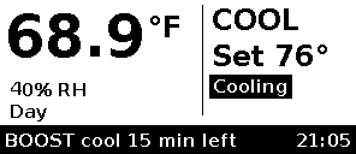

### Boost wire protocol (cluster 0xFC57, manufacturer code 0x131B)
| Attr | Type | Access | Meaning |
|---|---|---|---|
| 0x0000 | int16 | RW | boost target, 0.01 °C |
| 0x0001 | uint16 | RW | timed boost length, minutes (1–120) |
| 0x0002 | enum8 | RW | 0 auto, 1 heat, 2 cool |
| 0x0003 | enum8 | W | 1 start to target, 2 start timed, 0 cancel |
| 0x0004 | enum8 | R, reported | 0 off, 1 heating to target, 2 cooling to target, 3 timed heat, 4 timed cool |
| 0x0005 | uint16 | R, reported | minutes remaining |
| 0x0006 | enum8 | R, reported | last result (see `zb_boost.h`) |

The device sends attribute reports for 0x0004–0x0006 to the coordinator itself whenever they
change, so ZHA doesn't have to configure reporting on the custom cluster.

## Why a (sleepy) end device and not a router

The board runs off the C wire, so power isn't a constraint, but **heat is**. A Zigbee router has to keep
its 802.15.4 receiver on all the time (tens of mA at 3.3 V, plus a CPU that never sleeps). That's a steady
~0.1–0.3 W heat source a few centimetres from the SHT40, which reads high by a varying amount. The thermal
island and slots help, but they don't cancel it out. As an **rx-off-when-idle end device**, the radio sleeps
between polls and the CPU can auto-light-sleep (`CONFIG_PM_ENABLE`, tickless idle,
`esp_zb_sleep_enable`). The cost is latency: a command from Home Assistant waits until the next poll. The
long-poll interval is **3 s** (`CONFIG_THERMO_ZB_LONG_POLL_MS`), which is fine for a thermostat and stays
well under a parent's ~7.7 s indirect-transmit timeout. The other cost is that the thermostat doesn't
extend your mesh, which mains-powered plugs and bulbs handle better anyway. The LED stays off unless
something needs attention, for the same self-heating reason.

`CONFIG_ZB_ZED=y`. To build a router later, switch to `CONFIG_ZB_ZCZR`, set `ESP_ZB_DEVICE_TYPE_ROUTER`,
drop `esp_zb_sleep_enable` / `set_rx_on_when_idle(false)`, and re-measure the temperature offset.

## Zigbee data model (endpoint 1, HA profile, device 0x0301 Thermostat)

| Cluster | Role | Attributes |
|---|---|---|
| Basic 0x0000 | server | manufacturer `Connie`, model `thermostat-v3`, power source mains, sw build |
| Identify 0x0003 | server | identify time → LED blinks |
| Thermostat 0x0201 | server | LocalTemperature, Occupied Heating/Cooling Setpoint (writable; = current program period, writes edit that period), SystemMode off/cool/heat (writable; Auto 0x01 is refused and the real mode re-published), ControlSequenceOfOperation = 4 (cool and heat), ThermostatRunningState (bit0 heat, bit1 cool, bit2 fan), Abs/Min/Max setpoint limits (no MinSetpointDeadBand any more), LocalTemperatureCalibration ±2.5 °C (writable, persisted) |
| Fan Control 0x0202 | server | FanMode on/auto (writable, persisted; other values map to On, Off maps to Auto), FanModeSequence = 4 (On/Auto) |
| Time 0x000A | client | Reads the coordinator's LocalTime for the program schedule |
| Temperature Measurement 0x0402 | server | MeasuredValue (same calibrated value) |
| Relative Humidity 0x0405 | server | MeasuredValue |
| OTA Upgrade 0x0019 | client | manufacturer 0x131B, image type 0x0301, file version `FW_OTA_FILE_VERSION` (0xMMmmpppp, derived from `FW_VERSION`) |

Changes made on the device (buttons) are written into the local attributes, so configured reports pick them up.

## Local UI

| Input | Action |
|---|---|
| UP / DOWN | Main screen: setpoint ±1 °F (or ±0.5 °C). Auto-repeats after 0.6 s. HEAT edits the heat setpoint, COOL edits the cool setpoint, in both cases **of the current program period** (persisted). Ignored in OFF |
| UP + DOWN | Start a timed boost, or cancel the running one |
| M (short) | Open the menu |
| M hold 5 s | Bottom bar: *Let go: pair / hold on: reset*. **Releasing between 5 and 8 s starts pairing** |
| M hold 8 s | Full-screen **factory reset warning** ("keep holding M to reset, release to cancel"). Releasing now cancels and the screen is restored with a full refresh |
| M hold 15 s | **Factory reset**: outputs off, settings erased, leave the network, reboot |
| RESET pinhole | Hardware reset |

Debounce is 30 ms. Fan On/Auto is in the menu (*Fan*) and in HA.

Pairing is triggered on *release* in the 5–8 s window rather than at 5 s, so a hold that goes on to
a factory reset never starts pairing on the way. A short press is a release before 1.5 s; a release
between 1.5 and 5 s does nothing. Long holds only do this on the main screen; in the menu they're
ignored (except *Zigbee → hold M*), and after a hold action the rest of that hold is swallowed.

### Menu

UP/DOWN move (wrapping), M selects. Editors: UP/DOWN change, M saves. **10 s without a key anywhere
in the menu returns to the main screen without saving.** Leaving the menu (Back, a boost start,
timeout) does a full refresh to clear ghosting; inside the menu each key press is a partial refresh,
and the usual every-20th-refresh full refresh still applies.

| Item | What it does |
|---|---|
| Mode | Off / Heat / Cool |
| Fan | Auto / On (On runs the blower continuously, even with no heating/cooling) |
| Schedule | The 10 program knobs (list below), each opens an editor |
| Boost → To target | Set the target (0.5 °C / 1 °F steps, 10–32 °C), M starts it |
| Boost → For N minutes | 15–120 min in 15 min steps, M starts it |
| Boost → Cancel boost | Only listed while a boost runs |
| Schedule → Heat/Cool day/night start | HH:MM in 15-min steps, wraps around midnight (a stored odd minute from HA snaps to the nearest 15) |
| Schedule → Heat/Cool day/night temp | 0.5 °C / 1 °F steps, 10–32 °C |
| Schedule → Morning boost time | 0–240 min in 15-min steps, 0 = off |
| Schedule → Morning boost + | 0–3.0 °C in 0.1 °C steps (shown as a °F difference in °F) |
| Swing | ±0.1–1.0 °C in 0.1 °C steps (shown converted when the units are °F) |
| Units | °C / °F for the display (persisted; Kconfig sets the factory default; display only, HA keeps its own units) |
| Zigbee | Link status; **hold M (1.5 s)** to start pairing |
| Device info | Firmware version, raw (uncalibrated) temperature and RH, uptime |
| Back | Main screen |

Changes go through the same paths as the buttons and HA: mode via the Thermostat cluster, boost
target/duration and swing via the 0xFC57 attributes (written locally and reported, so HA sees them),
boosts through the same command queue as HA's Start/Cancel buttons; schedule edits go to NVS and are
reported on 0xFC57/0x0020–0x0029 like the HA-side edits (same clamps as the Zigbee writes). The logic is a pure state
machine in `components/ui/menu.c`, unit-tested on the host (`test/host/test_menu.c`, including the
hold timings fed through the real debouncer).

| | | |
|---|---|---|
| 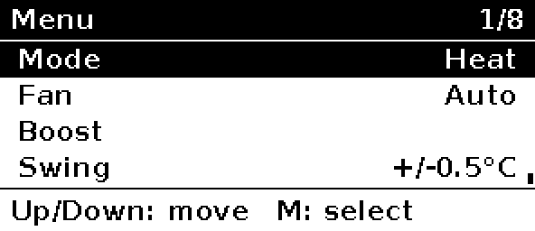 | 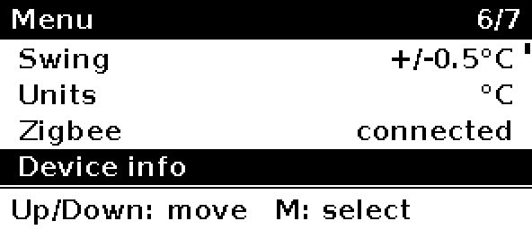 | 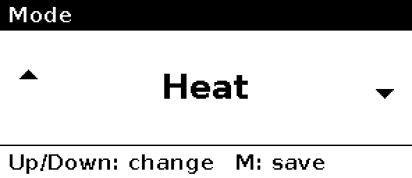 |
| 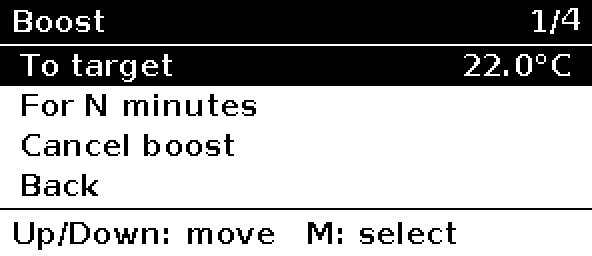 | 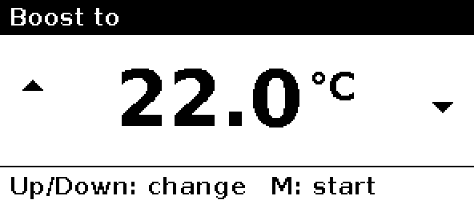 | 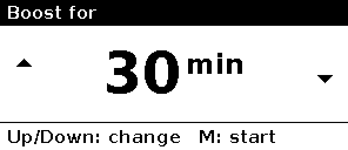 |
| 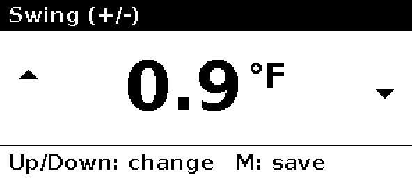 | 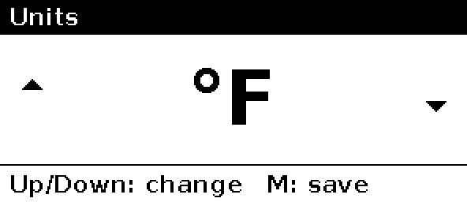 |  |
| 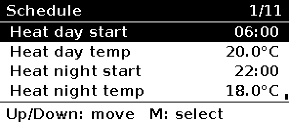 | 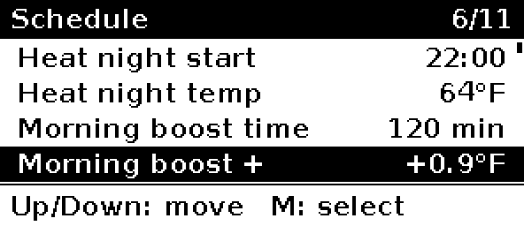 | 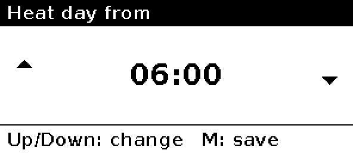 |
| 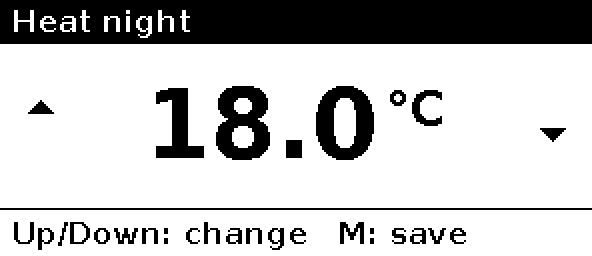 | 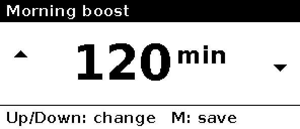 | 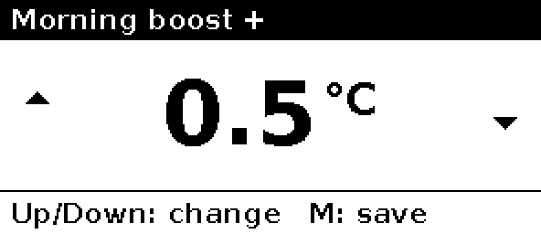 |
| 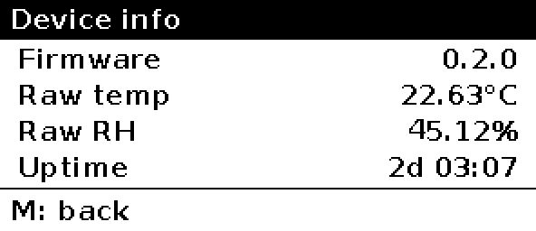 | 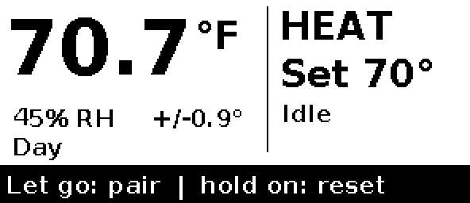 |  |
Display refreshes: a partial refresh ~0.4 s after a button change. Background changes (temperature,
humidity, running state, link) refresh at most every 3 min, as partials. Every 20th refresh, or every
6 h, is a full refresh to clear ghosting. The panel deep-sleeps between refreshes. Displayed temperature
is rounded to 0.1 °C before comparing, so sensor noise doesn't trigger refreshes.
Settings (mode, fan, the program schedule, calibration, boost preferences, swing, units) are saved to NVS 5 s after the last change.

## Building

```sh
# one-time: ESP-IDF v5.3.x
git clone -b v5.3.2 --recursive https://github.com/espressif/esp-idf.git ~/esp/esp-idf
~/esp/esp-idf/install.sh esp32c6
. ~/esp/esp-idf/export.sh

cd firmware
idf.py set-target esp32c6     # first time only
idf.py build                  # pulls esp-zigbee-lib / esp-zboss-lib 1.6.x via the component manager
```

Options are under `idf.py menuconfig` → *Thermostat V3* / *Thermostat Zigbee*: °F/°C, a fixed
self-heating offset, sensor period, the STWD100 arm switch (turn it off for JTAG debugging), poll
interval and OTA identifiers.

### Host unit tests

```sh
tools/run_host_tests.sh       # cmake + gcc/clang only; builds with -Werror and ASan/UBSan
```

### HOOTL simulation (hardware-out-of-the-loop scenarios)

```sh
idf.py reconfigure            # once: fetches esp-zigbee-lib (headers used by the simulator)
tools/run_hootl.sh            # build test/hootl + run every scenario (~25 s, parallel)
tools/run_hootl.sh -k sht40 --keep /tmp/hootl   # subset; keep logs + framebuffers (fb_NNN.pbm)
python3 test/hootl/hootl.py --list              # scenario names + what each asserts
```

The **unmodified** firmware (`main/*.c` and every component, including
`zb_thermostat.c`, the control loop, settings codec, menu, renderer and SSD1680/SHT40
drivers) is compiled for the host against fake ESP-IDF / FreeRTOS headers in
`test/hootl/fake/` and the real esp-zigbee-lib headers. The fakes sit at the lowest
layer the firmware calls: GPIO pads, the I2C master transaction, SPI transfers, NVS,
`esp_ota_*`, `esp_timer`, the task watchdog and `esp_zb_*`. So clamping, Auto refusal,
time sync, OTA pending-verify and rollback all run the shipping code.

* **Deterministic virtual time.** A cooperative kernel runs one FreeRTOS task at a
  time (pthreads passing one baton); when every task is blocked, time jumps to the next
  wake-up. 1 tick = 1 ms. Three simulated hours take about 5 s, and the same seed gives
  the same trace. All randomness (sensor noise, intermittent faults, bounce) comes
  from `--seed`.
* **One process = one boot.** A reset (`esp_restart`, STWD100, task WDT, OTA reboot,
  `power cycle`) saves NVS, OTA slot state, Zigbee join state, sticky hardware faults
  and the clock to a state file and exits with code 3. The runner relaunches the
  simulator on the same file, the same way the hardware reboots onto the same flash.
* **Peripheral models:**
  * an SHT40 with a room thermal model;
  * the STWD100: reset if WDI has no edge for 1.6 s while ~EN is low;
  * an SSD1680 that decodes DC/RAM writes, models BUSY timing, and dumps each refresh
    as a PBM (`EPD refresh ... ink= crc=` lines);
  * scripted buttons with bounce;
  * a Zigbee coordinator: join/steer, leave, parent loss, Time cluster, OTA server,
    remote writes;
  * a stall, death or failure of every Zigbee init call.
* **Scenarios** (`test/hootl/scenarios.py`) are scripts of `<ms> <command>` lines.
  They assert on the structured `@<ms> EVT ...` / `GPIO` / `ZB` lines. Each scenario has
  a wall-clock timeout and a boot budget. The runner also fails on a panic,
  `ESP_ERROR_CHECK`, sanitizer output, Zigbee lock misuse, or more boots than allowed.
* **Safety monitor, run after every scenario over the whole W/Y/G trace, across reboots:**
  * W and Y never on together;
  * Y off ≥ 5 min (from the last Y-off or from power-on);
  * W off ≥ 60 s;
  * 5 min heat↔cool changeover gap;
  * G on whenever Y is on;
  * min-on: W ≥ 2 min, Y ≥ 3 min, unless a failsafe, output fault, mode change, reset,
    safe mode, OTA, rollback or factory reset happened within 1 s of the stop;
  * all outputs off while the control failsafe (`EVT ctrl fault≠OK`) or safe mode is active;
  * all outputs low from reset until `EVT cfg loaded`.

  `hootl.py --selftest` (run by `tools/run_hootl.sh`) feeds the monitor seeded
  violations and checks each is flagged.

  Pins a scenario deliberately breaks are exempt after the fault is injected. A
  mutation check: setting the compressor min-off to 1 s makes the monitor fail
  `cool_cycles_room_model`.
* **CI** (`.github/workflows/firmware.yml`):
  * a production `idf.py build` that fails on any warning;
  * `tools/check_release.sh` (no `sim_*`/fake symbols or simulator strings in the ELF);
  * host unit tests, ZHA quirk tests, and every HOOTL scenario (JUnit XML).
* **SIM isolation.** No firmware source has a simulator ifdef. The simulator is purely
  a different build (`test/hootl/CMakeLists.txt`), and `tools/check_release.sh` asserts
  that no simulator code reaches the firmware ELF.
* **Why not the IDF `linux` target.** In IDF 5.3 the linux target has no GPIO, SPI,
  I2C, OTA, power-management or 802.15.4 drivers (those components build as
  "unsupported"). Its FreeRTOS POSIX port also runs in wall-clock time and is
  preemptive and non-deterministic. Hours-long scenarios would take hours and flake.
  The plain-CMake host build gets the same "real sources, fake HAL" result
  deterministically.

**What it does not cover (still needs the bench / hardware bring-up checklist):**
* real drivers and silicon: the IDF GPIO/SPI/I2C drivers, the IEEE 802.15.4 radio
  and esp-zigbee-lib's own code (only its API contract is modelled);
* real timing: ISR latency, SPI/I2C clock-stretching, flash write time, true
  preemption (the cooperative kernel cannot show priority-inversion or data-race
  bugs; the host unit tests' sanitizers cover some of that);
* light sleep, RTC and wake-up sources; brownout and supply droop; reset-pin levels
  and the real pull-up/down behaviour of the pads between reset and `gpio_config`
  (modelled as "low");
* the real STWD100's tolerance (tWD 1.12–2.08 s; the model uses 1.6 s) and its
  power-on ~EN timing;
* output faults beyond the pad: readback sees only the GPIO pad level, so a **shorted
  triac**, an open triac, a dead MOC3063 or a field-wiring fault downstream of the pin is
  not detected. The pad-readback timing (synchroniser delay modelled as 2 µs) and that a
  pad loaded by the MOC3063 LED still reads its driven level must be verified on real
  hardware with the MOC3063s fitted;
* the Zigbee stack's exact signal ordering: the fake follows esp-zigbee-lib 1.6 as
  documented (OTA: START, RECEIVE…, APPLY, CHECK, FINISH; ZED reboot with no network is
  modelled both as REBOOT(OK)+NO_ACTIVE_LINKS_LEFT and as REBOOT(ESP_FAIL)). Server-side
  OTA timeouts are modelled as a stall (no ABORT from the stack);
* the e-paper's actual optics (the framebuffer is checked, not the panel).

#### Failure-mode coverage

Every row also passes the safety monitor.

| Peripheral | Failure mode | Scenario(s) | Expected (asserted) behaviour |
|---|---|---|---|
| SHT40 | NAK (no ACK) | `sht40_nak` | SENSOR FAIL within 30 s; W/Y/G **all** off incl. Fan ON; Zigbee unaffected; recovers after 3 good readings |
| SHT40 | bus stuck / timeout | `sht40_bus_stuck_timeout` | same |
| SHT40 | CRC error | `sht40_crc_error` | same |
| SHT40 | intermittent (100% / 30%) | `sht40_intermittent_100pct`, `sht40_intermittent_30pct_keeps_control` | 100%: failsafe + recovery; 30% (seeded): readings still arrive, no fault, keeps heating |
| SHT40 | stuck/frozen value | `sht40_frozen_value` | identical reading for 20 min → frozen → failsafe; clears when values move |
| SHT40 | implausible value (90 °C) | `sht40_out_of_range` | TEMP RANGE fault, all off; recovers |
| SHT40 | absent from power-on | `sht40_absent_at_boot` | never leaves failsafe, nothing on, no reboot |
| SHT40 | I2C driver init fails | `sht40_bus_init_fails` | sensor fault, rest of system runs |
| STWD100 | missed kick (app hang) | `stwd100_missed_kick_resets` | reset 1.6 s after last WDI edge; outputs low; normal boot after |
| STWD100 | reset mid-heat / power cut mid-cool | `reset_mid_heat_keeps_heat_off_time`, `reset_mid_cool_keeps_compressor_off_time` | W ≥ 60 s / Y ≥ 5 min off across the reboot |
| STWD100 | repeated resets (boot loop) | `boot_loop_enters_safe_mode` | 5th counted boot: SAFE MODE, outputs off, STWD100 not armed; retries normal boot after 30 min |
| Boot guard | software resets (factory reset ×6, OTA ×5) | `bootloop_sw_resets_not_counted`, `bootloop_ota_reboots_not_counted` | counter does not move, never safe mode |
| Boot guard | power-on resets | `bootloop_power_cycles_counted` | counted (STWD100 looks like power-on): 5th boot is safe mode |
| Boot guard | counter cleared by stable uptime | `bootloop_counter_clears_after_3_min` | cleared after 3 min; next 4 resets stay below the limit |
| Boot guard | safe-mode retry | `bootloop_safe_mode_single_trial_boot` | trial boot has count 4; it hangs once → straight back to safe mode |
| Boot guard | factory reset | `bootloop_count_survives_factory_reset` | count survives (4 → factory reset → 4 → power cycle → safe mode) |
| Task WDT | hang before STWD100 armed | `task_wdt_before_stwd_armed` | task watchdog resets |
| E-paper | BUSY stuck | `epd_busy_stuck` | control continues; no reboot |
| E-paper | SPI error | `epd_spi_error` | error reported by `ssd1680_show`; control continues |
| E-paper | init failure | `epd_init_fail` | display fault reported; control continues |
| E-paper | SPI hang (display task stalls) | `epd_spi_hang` | display fault reported; **not** treated as unhealthy (no reboot loop) |
| E-paper | framebuffer content | `boot_idle`, `epd_framebuffer_shows_radio_fault` | non-blank first frame; radio-fault screen drawn |
| Buttons | M stuck pressed at boot | `button_mode_stuck_at_boot` | ignored until released: no pairing, no factory reset |
| Buttons | UP stuck during runtime | `button_up_stuck_runtime` | auto-repeat stops after 30 s; setpoint bounded |
| Buttons | bounce | `button_bounce_single_step` | exactly one step |
| Buttons | factory reset 15 s / release at 14.9 s | `factory_reset_hold_15s`, `factory_reset_release_at_14_9s_cancels` | erase + reboot to defaults / nothing erased |
| Buttons | pairing window | `pairing_window_5_to_8s` | 4.9 s: nothing; 6 s: steering at release |
| NVS | empty / corrupt / wrong size / empty blob / old v0.2.1 key | `nvs_empty`, `nvs_corrupt_blob`, `nvs_wrong_size_blob`, `nvs_empty_blob`, `nvs_old_v021_cfg_key` | blob rejected, defaults, no reboot |
| NVS | read failure / open failure at boot | `nvs_read_fail`, `nvs_open_fail_at_boot` | defaults, keeps running |
| NVS | write / commit / open failure, full | `nvs_write_fail`, `nvs_commit_fail`, `nvs_open_fail_runtime`, `nvs_full` | new value used from RAM, "not saved" fault, retried once a minute, saved when flash recovers |
| NVS | no free pages / new version | `nvs_init_no_free_pages`, `nvs_init_new_version` | erased + re-initialised |
| NVS | partition missing / init error | `nvs_partition_missing`, `nvs_init_generic_fail` | defaults in RAM, storage fault shown, **no** ESP_ERROR_CHECK reboot loop |
| NVS | settings survive reboot | `nvs_roundtrip_settings_survive_reboot` | restored |
| OTA | pending-verify, never joins | `ota_pending_never_joins_rolls_back` | rolls back at 10 min (outputs off first) |
| OTA | pending-verify, joins | `ota_pending_joins_confirms` | confirmed after ≥ 60 s healthy |
| OTA | rollback impossible | `ota_rollback_impossible_keeps_running` | keeps image, marks valid, no reboot, **no output blip** |
| OTA | full update | `ota_full_update_and_confirm` | outputs off before reboot, boots slot 1 pending, confirms |
| OTA | flash write error | `ota_write_error` | transfer aborted, no reboot, control continues |
| OTA | image invalid / unknown tag | `ota_image_invalid`, `ota_wrong_element_tag` | rejected, boot partition unchanged |
| OTA | no partition / begin fails / set-boot fails | `ota_no_partition`, `ota_begin_fails`, `ota_set_boot_fails` | refused, stays on old image |
| OTA | server abort / stall / no image | `ota_server_abort_mid_transfer`, `ota_server_stalls_banner_cleared`, `ota_unavailable` | clean abort; banner cleared after 5 min stall; nothing |
| OTA | link lost mid-transfer | `ota_link_lost_mid_transfer` | aborted; rejoins |
| Clock | never synced | `time_never_synced` | DAY program; Time reads back off 1, 2, 5 min then hourly |
| Clock | TimeStatus unset / bogus epoch | `time_status_unset`, `time_bogus_epoch` | ignored, time stays unknown |
| Clock | jump back across boost window | `time_jump_back_across_boost_window` | follows new clock (night), boosts again at 06:00 |
| Clock | DST shift / sync lost then restored | `time_dst_shift`, `time_sync_lost_then_restored` | local time shifts 1 h / stays known, resyncs |
| Clock | schedule wraps midnight | `schedule_night_wraps_midnight`, `schedule_morning_boost_mocked_time` | night holds across 00:00; boost window correct |
| Zigbee | platform config / register / start fails; task create fails | `radio_platform_config_fails`, `radio_device_register_fails`, `radio_stack_start_fails`, `radio_zigbee_task_create_fails` | "radio fault" link state; **no reboot**; local control (buttons) works |
| Zigbee | stack init signal fails ×3 | `radio_stack_init_signal_fails_then_ok` | retried with backoff, joins |
| Zigbee | join never succeeds | `radio_join_never_succeeds` | backoff (≤ 14 attempts in 2 h), keeps heating |
| Zigbee | parent lost / network down / leave | `radio_link_lost_mid_run_rejoins`, `radio_link_lost_coordinator_down`, `radio_leave_then_repair`, `radio_reboot_with_network_down`, `radio_reboot_network_down_reboot_fail_variant` | rejoin via backoff; control continues |
| Zigbee | flapping link | `radio_flapping_link_backs_off` | backoff not reset by short joins (≤ 16 attempts in 2 h) |
| Zigbee | task stalls / dies | `radio_zigbee_task_stalls`, `radio_zigbee_task_dies` | radio fault within 60–70 s; UI pairing does not block main loop; no reboot |
| Zigbee | remote writes: Auto, out-of-range setpoint, burst, while lost | `remote_auto_write_refused`, `remote_setpoint_clamped`, `sht40_*` (mode+fan burst), `radio_remote_writes_while_lost` | refused/clamped; burst writes all apply; local changes apply offline |
| Outputs | W pad stuck high | `output_w_stuck_high`, `output_w_stuck_high_no_retest` | readback → OUTPUT FAULT latched; Y/G held low; no reboot; pads never read "off" so never re-tested |
| Outputs | one stale / glitched readback | `output_readback_single_glitch_tolerated`, `output_readback_stale_read_model` | no fault (fake returns the pre-write level for same-instant reads; readback is on the next pass) |
| Outputs | 2 consecutive mismatches, then healthy | `output_two_mismatches_latch_then_retest_recovers` | latched, all off; re-test after 10 min passes; cooling resumes respecting min-off |
| Outputs | transient W stuck low | `output_w_stuck_low_transient_recovers` | latched; re-test clears; heating resumes |
| Outputs | Y driver dead (stuck low) | `output_y_stuck_low_retest_gives_up` | 3 re-tests each re-latch, then off until reboot |
| Outputs | Y pad stuck low | `output_y_stuck_low_while_cooling` | mismatch → fault, all off |
| Outputs | G `gpio_set_level` fails | `output_g_set_fails` | fault; Y never runs without G |
| Outputs | W `gpio_config` fails at boot | `output_w_config_fails_at_boot` | no reboot loop; fault shown; all off |
| Normal operation | heat/cool cycling, changeover, fan, menu, setpoint keys, timed boost | `heat_cycles_room_model`, `cool_cycles_room_model`, `changeover_heat_to_cool`, `fan_on_and_auto`, `menu_navigation_buttons`, `home_up_down_setpoint`, `timed_boost_combo`, `boot_idle` | min on/off, changeover gap, G with Y, holds 20 °C ±1 |

## Flashing: USB ONLY WITH 24 VAC DISCONNECTED

> ⚠️ **Never plug USB in while the board is wired to the HVAC system.** Board ground is the
> bridge rectifier's negative node, not C. With 24 VAC connected, a USB cable to a grounded PC can
> push current through a rectifier diode and the PC's ground, which can damage the board, the PC or the
> HVAC transformer. The case has no USB opening on purpose. Take the board out of the case and unplug
> the HVAC terminal block first.

On the bench, with the board powered from USB only:

```sh
idf.py -p /dev/ttyACM0 flash monitor
```

The C6's native USB-Serial-JTAG enumerates on its own. If it doesn't (bad firmware, USB disabled),
hold **BOOT**, tap **RESET**, release BOOT, and flash again. The STWD100 stays disarmed while
flashing and in the bootloader, because its ~EN pull-up keeps it off until the firmware drives
IO11 low.

Once the device is on the wall, update it **over Zigbee OTA** (below) instead of USB.

## Pairing

The device starts network steering by itself whenever it isn't joined (on first boot or after a factory
reset) and retries every 10 s. The bottom line of the screen shows *Zigbee: pairing...*. To pair again
later: hold MODE for 10 s (factory reset), or hold it for 3 s if it's already unjoined.

### ZHA (primary)
Install the boost quirk first (`ha/zha_quirk/README.md`): add `zha: custom_quirks_path:` and copy
the file there. Then: Settings → Devices & services → Zigbee Home Automation → *Add device*, then power the thermostat or
start pairing. ZHA's generic thermostat support should pick up cluster 0x0201 and create a
`climate` entity (**with the quirk: hvac_modes off/heat/cool only, fan modes auto/on**; both setpoints, HVAC action from running state), plus
humidity and temperature sensors and a fan-mode control. No quirk should be needed. If the fan mode or
running state doesn't show up, a small ZHA quirk v2 can be added later.

#### Climate modes without Auto (ZHA)

ZHA builds the climate entity's `hvac_modes` from the Thermostat cluster's ControlSequenceOfOperation
(`SEQ_OF_OPERATION` in `zha/application/platforms/climate/const.py`, zha 2.3.1 = current upstream `dev`).
The standard value the firmware sends, 0x04 *Cooling and Heating*, maps to off/heat_cool/cool/heat, and **no
standard ZCL value means "heat or cool, but never auto"**. Options considered:

| Route | Verdict |
|---|---|
| Firmware sends 0x06 | Works for ZHA, but 0x06 is reserved in ZCL (ZHA labels it "centralite specific"); Z2M and other controllers would misread it. Rejected: keep the wire standard |
| **Quirk replaces the Thermostat cluster (chosen)** | `ConnieThermostatCluster` answers ZHA's cached read of ControlSequenceOfOperation with 0x06 → ZHA's own table yields exactly `[cool, heat, off]`. Also refuses a `system_mode = Auto` write locally. Uses only supported quirks v2 API (`.replaces()`), keeps ZHA's stock climate entity (setpoints, running state, fan modes), needs no extra install beyond the quirk Connie already uses. Tradeoff: depends on ZHA keeping its 0x06 table entry (pinned by `test_quirk.py`) |
| Custom ZHA climate entity class | ZHA entities are registered inside the `zha` library (`@register_entity` with `ClusterMatch`), not from custom quirks paths; would mean patching/forking the library. Rejected |
| HA custom integration / template climate wrapping the ZHA entity | Works, but duplicates the entity, its state handling and services; more moving parts. Rejected |
| Dashboard card `hvac_modes: [off, heat, cool]` | **Complementary UI tweak only** (already in `ha/dashboard-card.yaml`): hides the button on that card, but the entity, voice assistants, automations and other cards would still offer heat_cool |

Fan modes need nothing extra: ZHA's climate entity exposes `fan_modes` `[auto, on]` whenever the Fan Control
cluster is present. The firmware refuses Auto too, so a stale ZHA (no quirk) still can't put it in Auto.

### Zigbee2MQTT (secondary)
The converter includes the boost cluster: `boost_setpoint`, `boost_duration`, `boost_mode`,
`boost_command` (set `start_to_target` / `start_timed` / `cancel`), `boost_state`,
`boost_remaining` and `boost_last_result`. It loads cleanly with `zigbee-herdsman-converters`
(prepareDefinition lists all exposes) but hasn't been tested against a device.
Z2M only exposes devices it has a definition for. This model is custom, so **Z2M will list it as
"unsupported" unless you add the external converter** in `z2m/thermostat-v3.js`:
1. Copy it to `<z2m data>/external_converters/thermostat-v3.js` (Z2M 2.x). On 1.x, add it under
   `external_converters:` in `configuration.yaml` instead.
2. Restart Z2M, *Permit join*, then power or factory-reset the thermostat.
3. If it paired before the converter was installed, use *Reconfigure* so the converter's `configure()`
   sets up bindings and reporting.

The converter is written against the standard `fz.thermostat` / `tz.thermostat_*` helpers and is
**untested**, because no hardware exists yet. Its import paths may need adjusting for your Z2M version.

## OTA updates over Zigbee

> A freshly updated image confirms itself only after it has been up 60 s, is healthy, and has rejoined the Zigbee network. If it hasn't rejoined within 10 minutes (including when the coordinator/HA is simply offline), it rolls back to the previous image; the update will be offered again later. If no previous image exists, it logs an error and keeps running.

1. Bump `FW_VERSION_*` in `components/board/include/fw_version.h` (the OTA file version is derived from it) and build.
2. Wrap `build/thermostat_v3.bin` in a Zigbee OTA file with Espressif's
   `esp-zigbee-sdk/tools/image_builder_tool/image_builder_tool.py`, using manufacturer 0x131B, image type 0x0301 and the new version (e.g. 0.2.1 → 0x00020001).
3. **ZHA:** put the `.ota` file in the directory set by `zha: zigpy_config: ota: otau_directory`. **Z2M:**
   add it to a local OTA index (`ota: zigbee_ota_override_index_location`).
4. The device queries for updates once a day (the ZCL default), and HA can also trigger an update.
   Before rebooting into the new image, all outputs are turned off. Rollback is on, so a new image that
   isn't healthy within 60 s of boot (control loop running, sensor valid) is rolled back on the next reset.

## Bring-up checklist (before connecting 24 VAC)
1. With the board on USB and no HVAC, check that the log shows SHT40 readings and the screen draws.
   If the image is mirrored or upside down, build with `-DEPD_ROTATION=3` (see `gfx.c`).
2. Confirm that W/Y/G stay low at boot, in the bootloader, and during and after a forced watchdog
   reset (scope or LED on DRV_*).
3. Confirm that the STWD100 resets the chip when the loop is stalled (e.g. a debug build with a `while(1)`).
4. Measure self-heating: compare against a reference thermometer with the board in its case after 2 h,
   then set `CONFIG_THERMO_SELF_HEAT_OFFSET_C100`.
5. Only then connect R/C/W/Y/G. Do the first heat and cool calls while you're watching the equipment.

## Code style

All of our own C code (firmware, `test/host`, the HOOTL fakes in `test/hootl`) uses these conventions. Python is exempt and stays PEP 8.

| Kind | Convention | Example |
|---|---|---|
| Functions, struct/enum/typedef names | PascalCase | `HvacInterlock()`, `CtrlSettings` |
| Locals, parameters, struct fields | camelCase | `heatDrivesFan` |
| File-scope (and function-local) statics | `s_` prefix | `s_boostResult` |
| Globals (extern) | `g_` prefix | |
| Pointers | `p`, after the scope prefix | `pBuf`, `s_pState` |
| Constants, enum values | kCamelCase | `kCtrlModeHeat`, `kTag`, `kFontSmall` |
| Macros | UPPER_SNAKE | `SETTINGS_VERSION` |

Fixed-width types come from `components/core/include/core.h`: `U8 U16 U32 U64 I8 I16 I32 I64 F32 F64`. Use them instead of `uint8_t`/`int16_t`/`float`/`double`. Plain `int`, `char`, `bool` and `size_t` are fine where the width does not matter.

Exempt, never renamed:
- ESP-IDF, esp-zigbee and FreeRTOS names, types and callback signatures, including `app_main`. The HOOTL fakes keep the vendor names they implement. Our own `sim_*` fake helpers follow the rules.
- Zigbee attribute/cluster IDs and NVS key strings, and log strings (HOOTL greps them). On-wire and NVS layouts are unchanged.

Judgment calls:
- Static `const` tables and strings are constants, so they take `k` and not `s_`/`p` (`static const char *kTag`).
- Function-local statics take `s_`, the same as file statics.
- Opaque handle typedefs (`TaskHandle_t`, `QueueHandle_t`) and function pointers don't take `p`. Only a source-level `*` does.
- `const` locals stay camelCase. `k` is for static-storage constants.
- Macro-hygiene temporaries starting with `_` are left alone.
- A few functions got a verb so they don't clash with a type of the same name: `CtrlGetBoostStatus`, `SchedPeriodAt`, `MenuGetView`, `MenuOnKey`, `BuildMenuCtx`.

`tools/check_naming.py` checks all of this with libclang (`pip install libclang`). It reads the compile databases of the host-test, HOOTL and production builds, so build those first. It exits non-zero on any violation.
- Production files are parsed a second time with a variant config: `CONFIG_THERMO_DISPLAY_FAHRENHEIT`, `CONFIG_THERMO_HW_WDT_ENABLE` and `CONFIG_PM_ENABLE` off, and `EPD_ROTATION=3`. That way both sides of our `#if`s get checked.
- Branches neither config parses (`#if 0`, `#ifdef`s on macros no build defines) only get a name-shape check, word by word. Every identifier there must be a name declared somewhere, or must fit one of the conventions. Scope rules such as the `s_` prefix on statics can't be checked there, because the type and storage class are unknown. Calls (`name(` not preceded by a type) are skipped, so vendor functions used only in such a branch aren't flagged.
- Our `.c`/`.h` files that no compile database covers are parsed with a neighbouring file's flags.
- Names starting with `_` are violations. The exceptions are `__` names and the temporaries listed in `UNDERSCORE_ALLOW`, and those are allowed only when they come from a macro expansion. Written out literally, they are flagged too.

`tools/test_check_naming.py` is the checker's own test. It builds a small fixture tree and checks that each kind of bad name is flagged and that good code passes. It includes a `static int countBad;` in the `#else` of `CONFIG_THERMO_HW_WDT_ENABLE`, which has a valid shape and is caught only by the variant parse.

CI runs both in the host-test job. The production job also builds the Kconfig variant from `sdkconfig.variant` with `-DEPD_ROTATION=3`, and warnings fail that build too. To run it locally:

```bash
idf.py -B build-variant -DSDKCONFIG=build-variant/sdkconfig \
       -DSDKCONFIG_DEFAULTS="sdkconfig.defaults;sdkconfig.variant" -DEPD_ROTATION=3 build
```

Kconfig `bool` options are `#define`d to 1 when on and left undefined when off. Test them with `#if`/`#ifdef`, never inside a C expression.

### Formatting (clang-format)

`firmware/.clang-format` is the source of truth. It is based on clang-format's built-in **Microsoft** style (Allman braces, 4-space indent, 120 columns, no short `if`/loop/function/case on one line) with a few overrides:
- `case` blocks and unions get their braces on their own line too.
- `case` labels share the `switch` column (not indented).
- Include order is never sorted, because order matters (`sdkconfig.h`, `FreeRTOS.h` before `task.h`).
- Comments are never reflowed, so prose doc blocks and aligned field notes stay as written.
- Escaped newlines in macros align to the left.
- Long function calls and declarations break after `(` with one argument per line (no bin-packing).

A single-statement `if`/`for`/`while` puts its statement on the next line. Braces are optional there:

```c
if (!pS->valid)
    return false;
```

The version is pinned to **19.1.7** (`pip install clang-format==19.1.7`); other versions format differently. `tools/format.sh` formats all of our C (main/, components/, test/), and `tools/format.sh --check` is the CI dry run (`--dry-run -Werror`). `components/display/font_data.c` is generated and excluded. Code that clang-format can't lay out sensibly sits between `/* clang-format off */` and `/* clang-format on */`: macro-generated definitions without a trailing `;`, and calls inside macros that stringify the argument with `#x` (e.g. `TRY()` in `zb_thermostat.c`), where wrapping right after `(` would put a space into the log string.

### Doc comments

Every struct and every function in our own C code (firmware, host tests, HOOTL fakes) has a block comment right above it: `/** ... */` (a one-liner is fine). Only blank lines may come between the comment and the code. Plain `/* */` comments are for everything else (section banners, notes inside functions, trailing field notes).

Write the docs as natural prose sentences. Cover purpose, parameters, return value, units (0.01 °C, ms, virtual µs), side effects and locking/threading in flowing English. Do **not** use Doxygen tags (`@brief`, `@param`, `@return`, `@note`, and the rest) — they are visual clutter and `check_docs.py` rejects them.

- **Public functions:** the full doc goes on the prototype in the header. The definition in the `.c` file gets a brief comment, often just `/** See foo.h. */`.
- **Static functions:** the full doc goes on the definition. Forward declarations don't need one.
- **Functions generated by our own macros** (e.g. `MK(...)`/`ADD(...)` in `esp_zb_fake.c`): the doc goes on the macro's `#define`.
- **Structs:** a comment on the definition (on the `typedef` line for a typedef'd struct). Fields get trailing `/* */` notes wherever their meaning, units or invariants aren't obvious. Structs nested in another struct or local to a function are covered by the outer comment.
- **Accuracy:** comments describe what the code does, not what it was meant to do. Update them in the same commit as the code.

`tools/check_docs.py` enforces this. It uses the same libclang setup, compile databases and file scope as `check_naming.py`, plus our files outside the databases. It exits non-zero and lists every struct or function without a preceding `/** */` block, and every doc that still uses a Doxygen `@` tag. CI runs it in the host-test job next to the naming check.

## Security

OTA images are not signature-checked; join uses open install-code policy (`install_code_policy`
false); USB Serial/JTAG console is on. Details and the Zigbee manufacturer-code situation
(`0x131B` = Espressif sample default): see the repo-root [README](../README.md#security) and
[MANUFACTURER_ID.md](../MANUFACTURER_ID.md).

## Known gaps / TODO
- **Not run on hardware.** The SSD1680 init and partial-refresh sequences follow Good Display's
  GDEY029T94 sample code, but haven't been checked against a real panel. Display rotation is a guess.
- The light-sleep benefit is limited for now. The 10 ms button-sampling timer and the 250 ms loop wake the
  CPU often. Next step: GPIO-interrupt wake for buttons (IO3/4/5 are LP-capable), with polling only while
  a button is held. Self-heating hasn't been measured in either mode.
- Default reporting isn't configured on the device. ZHA and Z2M set it up when the device joins. No
  manufacturer-specific attributes yet (fan run-on time, minimum-time overrides, °F/°C over Zigbee via the
  Thermostat UI Config cluster 0x0204).
- Boost: the remaining-minutes field on the screen follows the 3-minute background refresh limit, so
  it can lag by up to 3 minutes (HA gets it every minute). Boost options can only be edited from HA
  (locally only start/cancel). The quirk is tested with mocks against zha 2.3.1 / zha-quirks 2.3.0,
  not in a live HA instance.
- One program for every day of the week (no weekday/weekend split).
- The no-Auto climate modes in ZHA rely on ZHA's (non-standard, "centralite specific") 0x06 entry in its
  ControlSequenceOfOperation table; the quirk test pins that, so a ZHA change would show up there first.
- Occupancy and the setpoint raise/lower command are not implemented.
- The Z2M converter and ZHA behaviour are untested. The OTA flow is untested end to end.
- No feedback that a triac actually switched (pad readback only; a shorted triac is not detected), and no 24 VAC presence or C-wire detection (the hardware has none).
- Interlock fault handling is a deliberate "stop kicking and reboot"; the boot-loop guard turns a persistent one into safe mode after 5 counted resets.
