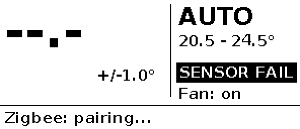

# Thermostat V3 firmware (prototype)

ESP-IDF firmware for **Connie's Super Awesome Thermostat V3**: an ESP32-C6 that runs as a Zigbee 3.0
HA thermostat for a single-stage gas furnace plus AC, with 24 VAC W/Y/G triac outputs.

> **Status: prototype.** It builds for esp32c6, and the host unit tests pass. It has **not run on
> real hardware yet**, because no V3 board exists. Check every item under *Bring-up checklist*
> before you wire it to the HVAC system.




*(Rendered on the host by the unit tests with the same rendering code the firmware uses.)*

## Layout

| Component | What it does | Hardware-free? |
|---|---|---|
| `components/control` | Thermostat logic: hysteresis, deadband, minimum on/off times, changeover, fan run-on, failsafe | **yes**, pure C |
| `components/hvac_outputs` | `hvac_interlock.c` (pure) is the **single** W/Y interlock. `hvac_outputs.c` is the only code that touches DRV_W/Y/G | interlock: yes |
| `components/sensor` | SHT40 over I2C (`sht40_parse.c` handles CRC and conversion and is pure) | parser: yes |
| `components/display` | SSD1680/GDEY029T94 driver, 1-bpp graphics plus fonts, screen renderer (pure), refresh-policy task | renderer: yes |
| `components/ui` | Button debounce, auto-repeat and long-press state machine (pure), 10 ms sampler, LED | state machine: yes |
| `components/zigbee` | Endpoint and cluster model, commissioning, attribute writes, OTA client | no |
| `components/board` | Pin map (`board.h`), STWD100 driver | no |
| `main` | Wires it all together; NVS settings; health check and watchdog kick | no |
| `test/host` | Native unit tests (CMake, no ESP-IDF needed) | |
| `z2m/thermostat-v3.js` | Zigbee2MQTT external converter | |

### Tasks
- **app** (prio 6, 250 ms loop): reads the sensor every 2 s, runs the control step, writes outputs through the interlock, handles button events, publishes to Zigbee, saves to NVS (with a 5 s debounce), drives the LED, runs the health check and kicks the watchdogs.
- **display** (prio 3): renders and refreshes the e-paper. A refresh blocks for seconds, so it gets its own task and the control loop never waits on the panel.
- **zigbee** (prio 5): ZBOSS main loop. Remote writes come in through callbacks and go into the shared settings under a mutex.
- **esp_timer**: 10 ms button sampling, which feeds a queue.

## Control and safety rules

All of these live in `control.c`, and the tests in `test/host/test_control.c` cover them.

| Rule | Default |
|---|---|
| Hysteresis | ±0.3 °C around the setpoint (heat on at SP−0.3, off at SP+0.3; cooling is the mirror image) |
| Auto deadband | cool SP − heat SP ≥ 1.5 °C (the setpoint you didn't edit moves) |
| Setpoint range | 10.0–32.0 °C |
| **Compressor minimum off-time** | **5 min**, also applied from boot, so a power blip can't short-cycle the compressor |
| Compressor minimum on-time | 3 min. Mode change or failsafe stops it immediately |
| Furnace minimum on/off | 2 min / 1 min |
| Heat↔cool changeover | 5 min between one stage stopping and the other starting |
| Fan run-on | G stays on 90 s after W and 45 s after Y. G is energised with Y. With W it's left to the furnace (`heat_drives_fan=false`) |
| **Failsafe** | No valid reading for 30 s, **or** a reading outside 0–45 °C, turns **all outputs off immediately** (overriding the minimum on-time and the fan run-on). Recovery needs 3 consecutive good readings. The firmware boots in failsafe |
| **W/Y interlock** | `hvac_interlock()` is the only path to the pins. If W and Y are both requested, both are dropped and a fault is counted. That fault makes the loop unhealthy, so it stops kicking and the watchdogs reset the chip |
| **Watchdog** | The STWD100 (about 1.6 s) is armed 10 s after boot, and only after the loop has run cleanly. It's kicked once per 250 ms loop, and only while the health check passes (display task alive, no interlock fault). The IDF task watchdog (5 s) watches the same loop as a second layer. A watchdog reset puts the GPIOs in high-Z, and the 10k pull-downs then switch every triac off |

A one-week randomised soak test (temperature drift, random mode and setpoint changes, sensor dropouts,
garbage readings) checks the invariants on every simulated second.

## Why a (sleepy) end device and not a router

The board runs off the C wire, so power isn't a constraint, but **heat is**. A Zigbee router has to keep
its 802.15.4 receiver on all the time (tens of mA at 3.3 V, plus a CPU that never sleeps). That's a steady
~0.1–0.3 W heat source a few centimetres from the SHT40, which reads high by a varying amount. The thermal
island and slots help, but they don't cancel it out. As an **rx-off-when-idle end device**, the radio sleeps
between polls and the CPU can auto-light-sleep (`CONFIG_PM_ENABLE`, tickless idle,
`esp_zb_sleep_enable`). The cost is latency: a command from Home Assistant waits until the next poll. The
long-poll interval is **3 s** (`CONFIG_THERMO_ZB_LONG_POLL_MS`), which is fine for a thermostat and stays
well under a parent's ~7.7 s indirect-transmit timeout. The other cost is that the thermostat doesn't
extend your mesh, which mains-powered plugs and bulbs handle better anyway. The LED stays off unless
something needs attention, for the same self-heating reason.

`CONFIG_ZB_ZED=y`. To build a router later, switch to `CONFIG_ZB_ZCZR`, set `ESP_ZB_DEVICE_TYPE_ROUTER`,
drop `esp_zb_sleep_enable` / `set_rx_on_when_idle(false)`, and re-measure the temperature offset.

## Zigbee data model (endpoint 1, HA profile, device 0x0301 Thermostat)

| Cluster | Role | Attributes |
|---|---|---|
| Basic 0x0000 | server | manufacturer `Connie`, model `thermostat-v3`, power source mains, sw build |
| Identify 0x0003 | server | identify time → LED blinks |
| Thermostat 0x0201 | server | LocalTemperature, Occupied Heating/Cooling Setpoint (writable), SystemMode off/auto/cool/heat (writable), ControlSequenceOfOperation = 4 (cool and heat), ThermostatRunningState (bit0 heat, bit1 cool, bit2 fan), Abs/Min/Max setpoint limits, MinSetpointDeadBand = 1.5 °C, LocalTemperatureCalibration ±2.5 °C (writable, persisted) |
| Fan Control 0x0202 | server | FanMode on/auto (writable), FanModeSequence = 4 (On/Auto) |
| Temperature Measurement 0x0402 | server | MeasuredValue (same calibrated value) |
| Relative Humidity 0x0405 | server | MeasuredValue |
| OTA Upgrade 0x0019 | client | manufacturer 0x131B, image type 0x0301, file version `CONFIG_THERMO_OTA_FILE_VERSION` |

Changes made on the device (buttons) are written into the local attributes, so configured reports pick them up.

## Local UI

| Input | Action |
|---|---|
| UP / DOWN | Setpoint ±1 °F (or ±0.5 °C). Auto-repeats after 0.6 s. HEAT edits the heat setpoint, COOL edits the cool setpoint, AUTO shifts both. Ignored in OFF |
| MODE (short) | OFF → HEAT → COOL → AUTO → OFF |
| MODE hold 3 s | Start pairing (network steering) if not joined |
| MODE hold 10 s | **Factory reset**: outputs off, settings erased, leave the network, reboot |
| RESET pinhole | Hardware reset |

Debounce is 30 ms. Fan On/Auto is currently Zigbee-only (see TODO).
Display refreshes: a partial refresh ~0.4 s after a button change. Background changes (temperature,
humidity, running state, link) refresh at most every 3 min, as partials. Every 20th refresh, or every
6 h, is a full refresh to clear ghosting. The panel deep-sleeps between refreshes. Displayed temperature
is rounded to 0.1 °C before comparing, so sensor noise doesn't trigger refreshes.
Settings (mode, fan, both setpoints, calibration) are saved to NVS 5 s after the last change.

## Building

```sh
# one-time: ESP-IDF v5.3.x
git clone -b v5.3.2 --recursive https://github.com/espressif/esp-idf.git ~/esp/esp-idf
~/esp/esp-idf/install.sh esp32c6
. ~/esp/esp-idf/export.sh

cd firmware
idf.py set-target esp32c6     # first time only
idf.py build                  # pulls esp-zigbee-lib / esp-zboss-lib 1.6.x via the component manager
```

Options are under `idf.py menuconfig` → *Thermostat V3* / *Thermostat Zigbee*: °F/°C, a fixed
self-heating offset, sensor period, the STWD100 arm switch (turn it off for JTAG debugging), poll
interval and OTA identifiers.

### Host unit tests

```sh
tools/run_host_tests.sh       # cmake + gcc/clang only; builds with -Werror and ASan/UBSan
```

## Flashing: USB ONLY WITH 24 VAC DISCONNECTED

> ⚠️ **Never plug USB in while the board is wired to the HVAC system.** Board ground is the
> bridge rectifier's negative node, not C. With 24 VAC connected, a USB cable to a grounded PC can
> push current through a rectifier diode and the PC's ground, which can damage the board, the PC or the
> HVAC transformer. The case has no USB opening on purpose. Take the board out of the case and unplug
> the HVAC terminal block first.

On the bench, with the board powered from USB only:

```sh
idf.py -p /dev/ttyACM0 flash monitor
```

The C6's native USB-Serial-JTAG enumerates on its own. If it doesn't (bad firmware, USB disabled),
hold **BOOT**, tap **RESET**, release BOOT, and flash again. The STWD100 stays disarmed while
flashing and in the bootloader, because its ~EN pull-up keeps it off until the firmware drives
IO11 low.

Once the device is on the wall, update it **over Zigbee OTA** (below) instead of USB.

## Pairing

The device starts network steering by itself whenever it isn't joined (on first boot or after a factory
reset) and retries every 10 s. The bottom line of the screen shows *Zigbee: pairing...*. To pair again
later: hold MODE for 10 s (factory reset), or hold it for 3 s if it's already unjoined.

### ZHA
Settings → Devices & services → Zigbee Home Automation → *Add device*, then power the thermostat or
start pairing. ZHA's generic thermostat support should pick up cluster 0x0201 and create a
`climate` entity (off/heat/cool/heat_cool, both setpoints, HVAC action from running state), plus
humidity and temperature sensors and a fan-mode control. No quirk should be needed. If the fan mode or
running state doesn't show up, a small ZHA quirk v2 can be added later.

### Zigbee2MQTT
Z2M only exposes devices it has a definition for. This model is custom, so **Z2M will list it as
"unsupported" unless you add the external converter** in `z2m/thermostat-v3.js`:
1. Copy it to `<z2m data>/external_converters/thermostat-v3.js` (Z2M 2.x). On 1.x, add it under
   `external_converters:` in `configuration.yaml` instead.
2. Restart Z2M, *Permit join*, then power or factory-reset the thermostat.
3. If it paired before the converter was installed, use *Reconfigure* so the converter's `configure()`
   sets up bindings and reporting.

The converter is written against the standard `fz.thermostat` / `tz.thermostat_*` helpers and is
**untested**, because no hardware exists yet. Its import paths may need adjusting for your Z2M version.

## OTA updates over Zigbee

1. Bump `CONFIG_THERMO_OTA_FILE_VERSION` and build.
2. Wrap `build/thermostat_v3.bin` in a Zigbee OTA file with Espressif's
   `esp-zigbee-sdk/tools/image_builder_tool/image_builder_tool.py`, using manufacturer 0x131B, image type 0x0301 and the new version.
3. **ZHA:** put the `.ota` file in the directory set by `zha: zigpy_config: ota: otau_directory`. **Z2M:**
   add it to a local OTA index (`ota: zigbee_ota_override_index_location`).
4. The device queries for updates once a day (the ZCL default), and HA can also trigger an update.
   Before rebooting into the new image, all outputs are turned off. Rollback is on, so a new image that
   isn't healthy within 60 s of boot (control loop running, sensor valid) is rolled back on the next reset.

## Bring-up checklist (before connecting 24 VAC)
1. With the board on USB and no HVAC, check that the log shows SHT40 readings and the screen draws.
   If the image is mirrored or upside down, build with `-DEPD_ROTATION=3` (see `gfx.c`).
2. Confirm that W/Y/G stay low at boot, in the bootloader, and during and after a forced watchdog
   reset (scope or LED on DRV_*).
3. Confirm that the STWD100 resets the chip when the loop is stalled (e.g. a debug build with a `while(1)`).
4. Measure self-heating: compare against a reference thermometer with the board in its case after 2 h,
   then set `CONFIG_THERMO_SELF_HEAT_OFFSET_C100`.
5. Only then connect R/C/W/Y/G. Do the first heat and cool calls while you're watching the equipment.

## Known gaps / TODO
- **Not run on hardware.** The SSD1680 init and partial-refresh sequences follow Good Display's
  GDEY029T94 sample code, but haven't been checked against a real panel. Display rotation is a guess.
- The light-sleep benefit is limited for now. The 10 ms button-sampling timer and the 250 ms loop wake the
  CPU often. Next step: GPIO-interrupt wake for buttons (IO3/4/5 are LP-capable), with polling only while
  a button is held. Self-heating hasn't been measured in either mode.
- Default reporting isn't configured on the device. ZHA and Z2M set it up when the device joins. No
  manufacturer-specific attributes yet (fan run-on time, minimum-time overrides, °F/°C over Zigbee via the
  Thermostat UI Config cluster 0x0204).
- Fan mode can't be changed on the device (no spare button). A possible future combo is MODE + UP.
- Setback/schedules, occupancy and the setpoint raise/lower command are not implemented (HA can schedule).
- The Z2M converter and ZHA behaviour are untested. The OTA flow is untested end to end.
- No feedback that a triac actually switched, and no 24 VAC presence or C-wire detection (the hardware has none).
- Interlock fault handling is a deliberate "stop kicking and reboot". A fault counter in NVS could stop boot loops.
