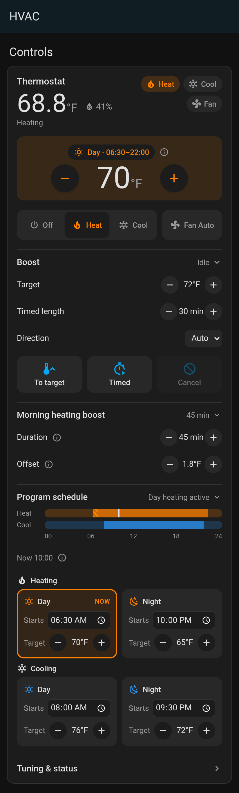
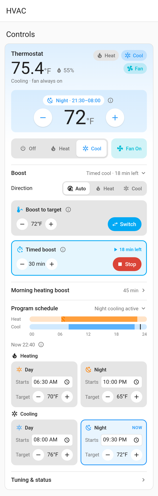

# Connie Thermostat V3 card

A custom Lovelace card for the thermostat, for Home Assistant with ZHA and the
[`connie_thermostat_v3` quirk](../zha_quirk/). It replaces the stock thermostat tile and the plain
number tiles with a single card that covers everything the quirk exposes.

| Light | Dark |
|---|---|
|  |  |
|  |  |

## What it shows

* **Room:** temperature and humidity, plus Heat / Cool / Fan chips for the running state (`hvac_action`, fan mode).
* **Setpoint:** − / + buttons with a badge for the active program period (Day, Night, Morning boost, or
  "Day (no clock)") and its hours. The caption names the program value the buttons change,
  e.g. *Changes the Day heating program setpoint*. On the thermostat, the setpoint *is* the current
  period's program temperature. Taps are batched (0.5 s) into one `climate.set_temperature`; an unsent value shows in italics
  with a dotted underline, and screen readers hear "sending…". The value is a keyboard slider: arrows ±1 step,
  PageUp/PageDown ±5, Home/End min/max.
* **Mode:** Off / Heat / Cool only (any Auto / heat_cool is filtered out), plus a **Fan On / Auto** toggle.
* **Program schedule:** a 24 h timeline for heating and cooling (day solid, night light, morning boost
  hatched, a marker for now). Below it, Day and Night tiles for each mode with the start time and target;
  the tile in use is outlined and tagged NOW.
* **Morning heating boost:** duration and offset.
* **Boost:** target, timed length, direction, To target / Timed / Cancel, and the live state with time left.
* **Tuning & status:** temperature swing, program period, last boost result.
* **Warnings:** device unavailable, no clock yet (holding the day program), and failed boosts (rejected, failsafe, limit).

### Units
Temperatures follow Home Assistant's unit system. HA already converts the climate entity and the
temperature-class number entities, e.g. to °F. The swing and the morning-boost offset are temperature
*differences*, so the quirk gives them no temperature device class and HA leaves them in °C. For a °F
user the card shows them ×1.8 (0.5 °C → 0.9 °F) and still writes °C values in the entity's own step.

## Install

The card is the single file `dist/connie-thermostat-card.js`. Lit and the icons are bundled in, so it
makes no network requests.

**Manual (Lovelace resource)**
1. Copy `dist/connie-thermostat-card.js` to `/config/www/connie-thermostat-card.js`.
2. Go to Settings → Dashboards → ⋮ → Resources → Add resource, enter URL `/local/connie-thermostat-card.js`
   and pick type *JavaScript module*. In YAML mode, add it under `lovelace: resources:` instead.
3. Reload the browser, then edit the dashboard → Add card → **Connie Thermostat V3**.

**HACS (custom repository)**
1. HACS → ⋮ → Custom repositories → `https://github.com/Connicpu/thermostat`, type *Dashboard*.
2. HACS installs `connie-thermostat-card.js` from the **GitHub release asset** (see the root `hacs.json`).
   The release workflow attaches it (see *Releasing*). This repo keeps the card in a subfolder, and HACS
   only looks in the repo root, its `dist/`, or release assets.

## Configure
The visual editor has a device picker, filtered to manufacturer `Connie` / model `thermostat-v3`, a name,
section toggles, and an *Entity overrides* panel. With no device set, the card uses the first Connie
thermostat it finds. Entities are matched on the device by the quirk's `translation_key`, then by
entity_id suffix (e.g. `_day_heating_start`). The editor reports how many of the 24 entities it found.
YAML options are in [`example.yaml`](example.yaml):

| Option | Default | Meaning |
|---|---|---|
| `device_id` | first Connie thermostat-v3 | Device to show |
| `name` | device name | Card title |
| `show_schedule`, `show_morning_boost`, `show_manual_boost`, `show_status` | `true` | Show or hide a section |
| `collapsed` | `[boost, status]` | Sections that start closed (`schedule`, `morning`, `boost`, `status`); they can still be opened by tapping. Listing a section here only adds to the defaults |
| `entities` | auto | Override any discovered entity (keys as in `src/model.js` `ENTITY_KEYS`) |

## Releasing
Push a tag named `card-vX.Y.Z` (e.g. `git tag card-v1.0.0 && git push origin card-v1.0.0`).
`.github/workflows/card-release.yml` runs the tests, checks that `dist/` matches a fresh build, then
attaches `dist/connie-thermostat-card.js` to that tag's GitHub release, creating the release if needed.
The workflow has only `contents: write`, and every action is pinned by SHA. Bump `CARD_VERSION`
(`src/connie-thermostat-card.js`) and `package.json` first. Firmware tags don't trigger it.

## Develop

```sh
npm ci
npm test              # vitest + happy-dom, mocked hass (test/mock-hass.js)
npm run build         # esbuild -> dist/connie-thermostat-card.js (commit it; CI checks it's up to date)
npm run screenshots   # headless system Chrome renders demo/ to screenshots/*.png (light + dark)
```

`demo/index.html` loads the built card with the mock hass and HA's default light/dark theme variables.
Serve this folder and open `demo/?theme=dark&scenario=cool-night`. The scenarios are `heat-day`,
`cool-night` and `morning-boost`.

Source: `src/model.js` (discovery, units and schedule maths; no DOM), `src/connie-thermostat-card.js`,
`src/editor.js`, `src/styles.js` and `src/icons.js`.
